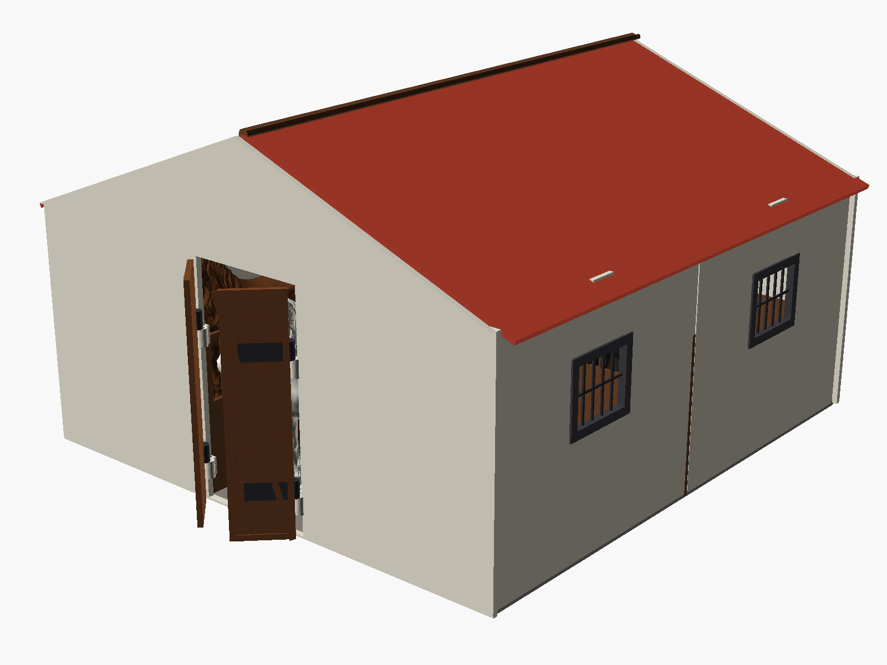

# 3D Models & Functional Prints

A collection of parametric, functional 3D printable designs engineered for desktop FDM 3D printers, with special optimization for the **QIDI Q1 Pro** ($245 \times 245 \times 240\text{ mm}$ build envelope).

---

## Projects

### 🐎 [Horse Stable Collection (1:24 Scale — Schleich Compatible)](stable/)

A comprehensive horse stable model collection designed for 1:24 scale model horses (Schleich, CollectA, Safari Ltd., Breyer 1:24, and custom 3D printed horses up to $150\text{ mm}$ tall).

| [Modular Stable (QIDI Q1 Pro Optimized)](stable/modular/) | [Standard Monolithic Stable](stable/standard/) |
| :---: | :---: |
|  |  |
| *Segmented dovetail panels ($\le 200\text{ mm}$), multi-color batches, expandable* | *Unified rigid shell ($353\text{ mm}$) for large-format 3D printers* |

* **[Modular Stable (`stable/modular/`)](stable/modular/):** Fully split into modular segments ($\le 200\text{ mm}$) for standard $245 \times 245\text{ mm}$ printer beds (QIDI Q1 Pro). Features dovetail joints, multi-color filament batching without AMS/MMU, and an included [Assembly Guide](stable/modular/ASSEMBLY.md).
* **[Standard Stable (`stable/standard/`)](stable/standard/):** Unified monolithic assemblies (perimeter walls, full roof, drop-in doors) for large-format 3D printers ($350\text{ mm}+$ beds).

👉 **[Explore Full Documentation & STLs in the stable/ directory](stable/)**

---

## Copyright

Copyright (c) 2026 **Bartosz Nowak**. All rights reserved.
