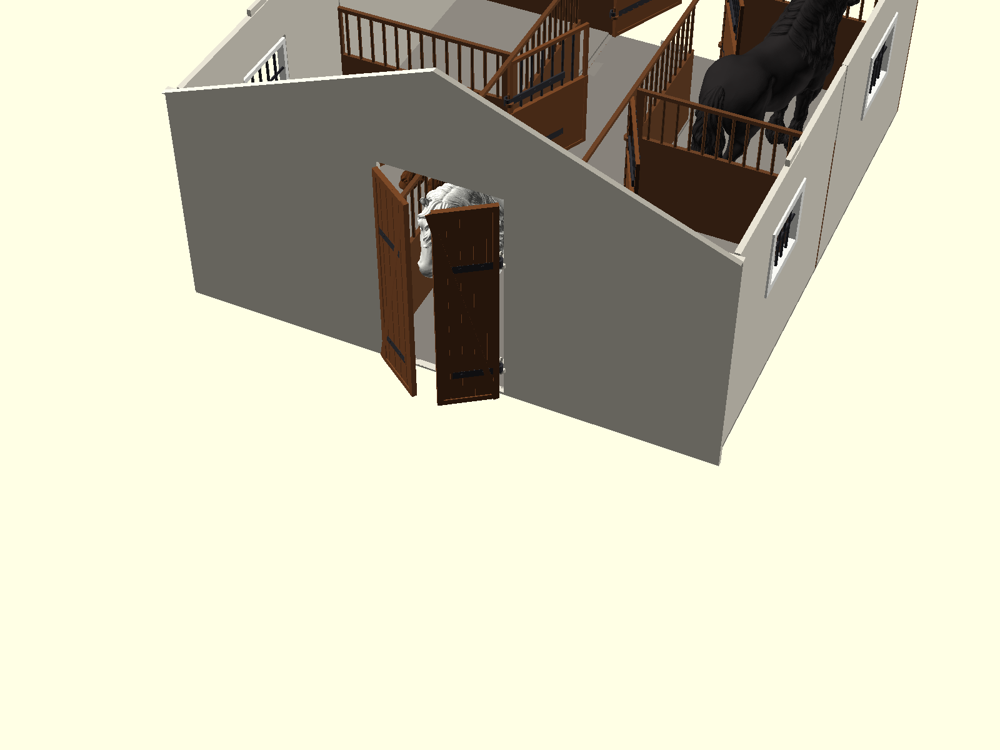

# 3D Models & Functional Prints

A collection of parametric, functional 3D printable designs engineered for desktop FDM 3D printers, with special optimization for the **QIDI Q1 Pro** ($245 \times 245 \times 240\text{ mm}$ build envelope).

---

## Projects

### 🐎 [Modular Horse Stable (1:24 Scale — Schleich Compatible)](stable/)

A fully modular, expandable horse stable system designed for 1:24 scale model horses (Schleich, CollectA, Safari Ltd., Breyer 1:24, and custom 3D printed horses up to $150\text{ mm}$ tall).

| Complete Stable Overview | Interior Stalls View |
| :---: | :---: |
|  |  |

* **Infinite Modularity:** Add as many 2-stall bay segments as you wish using interlocking dovetail floor joints.
* **100% QIDI Q1 Pro Compatible ($245 \times 245\text{ mm}$):** Every component is $\le 200\text{ mm}$, fitting easily on standard beds.
* **Multi-Color Printing Without AMS/MMU:** Pre-arranged into color batches (timber wood, stone floor, facade walls, terracotta roof, forged black hardware).
* **Authentic Functional Hinges:** Drop-in pintle-and-strap hinges for main barn gates and dutch stall doors without metal hardware.
* **Removable Roof:** Roof lifts off for top-down playtime access.

👉 **[Explore Full Documentation, STL Files & Assembly Guide in the stable/ directory](stable/)**

---

## License

This repository is open source under the **MIT License**. See [`LICENSE`](LICENSE) for details.

Copyright (c) 2026 **Bartosz Nowak**.
