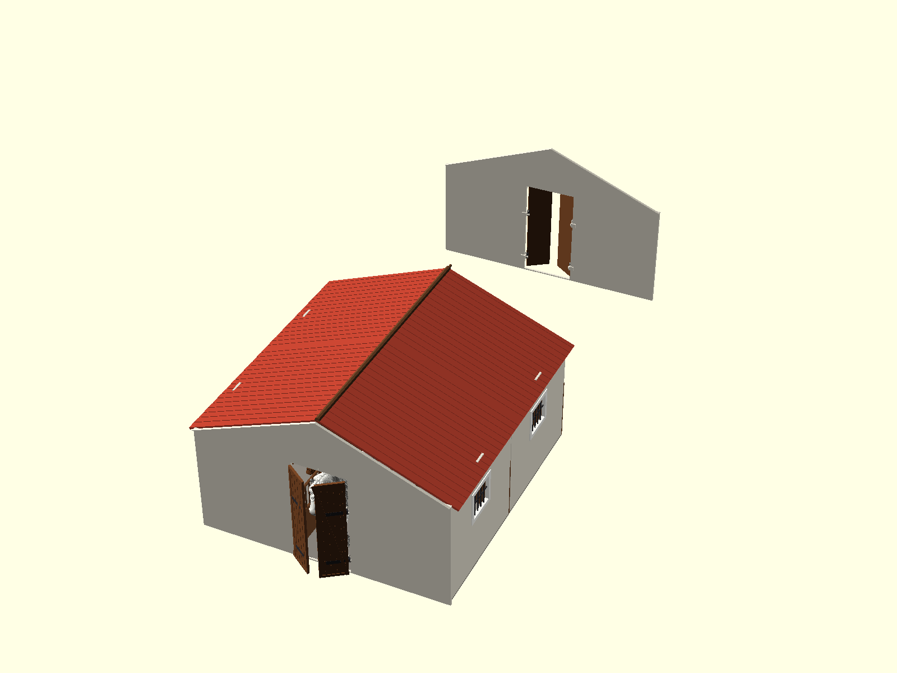
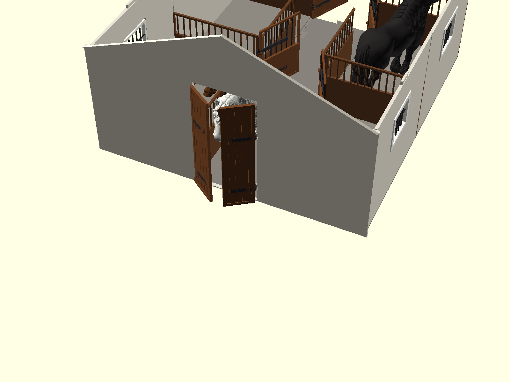

# 3D Models & Functional Prints

Kolekcja parametrycznych modeli 3D zoptymalizowanych pod drukarkę FDM **QIDI Q1 Pro** (pole robocze: 245 × 245 × 240 mm).

---

## Projekty

### 🐎 [Modułowa Stajnia dla Koni (Skala 1:24 - Schleich)](stable/)

W pełni rozbieralny i rozbudowywalny system stajenny dla koni w skali 1:24 (np. Schleich, Breyer). 

| Widok z Koniem | Wnętrze Boksów |
| :---: | :---: |
|  |  |

* **Dowolna liczba boksów:** system modułów szczepianych na zamki jaskółczy ogon (dovetail).
* **100% dopasowania do stołu QIDI Q1 Pro (245 × 245 mm):** żaden element nie przekracza 200 mm.
* **Mechaniczne zawiasy stajenne:** skrzydła nakładane od góry na sworznie ścienne bez użycia śrub.
* **Druk wielokolorowy:** podział na osobne panele (drewno, posadzka, tynk, dachówka, okucia).

👉 **[Zobacz pełną dokumentację i pliki STL stajni w folderze stable/](stable/)**
