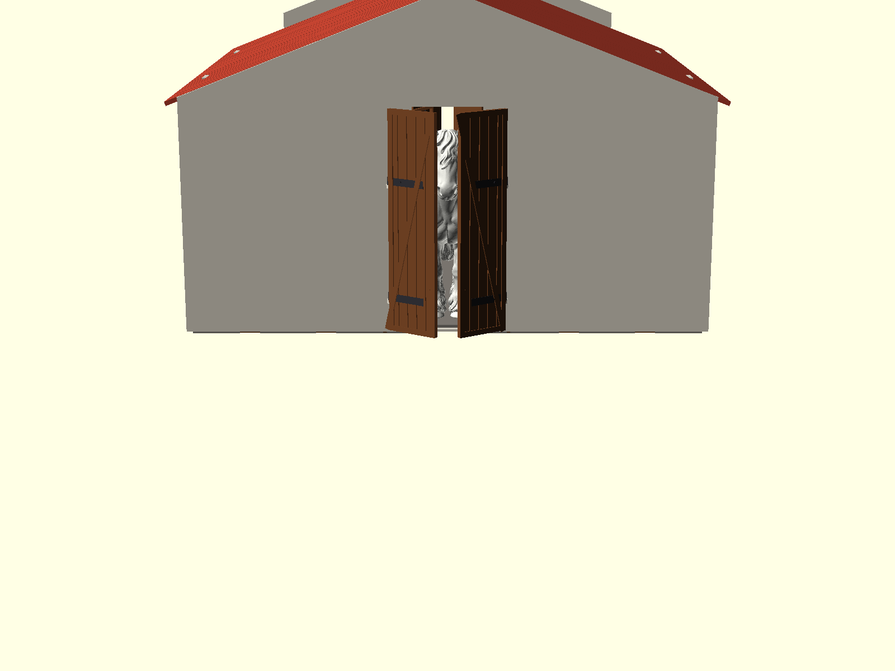
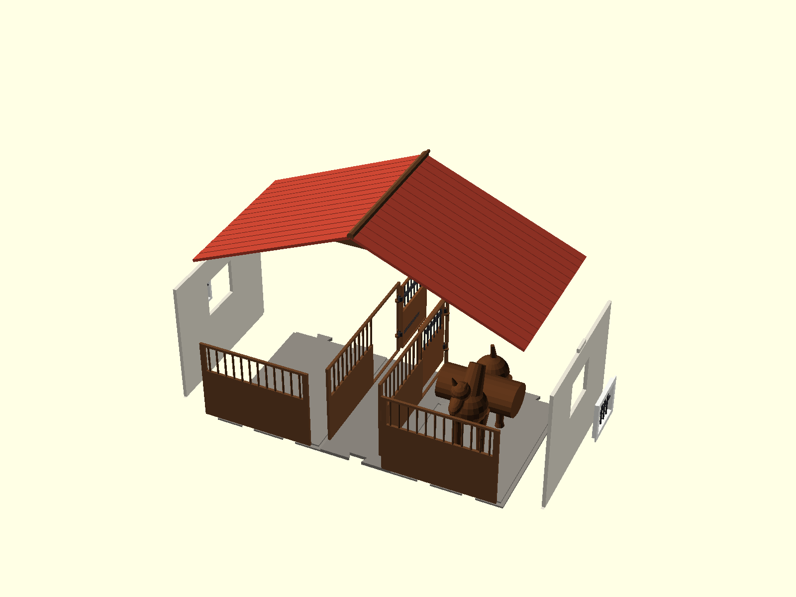
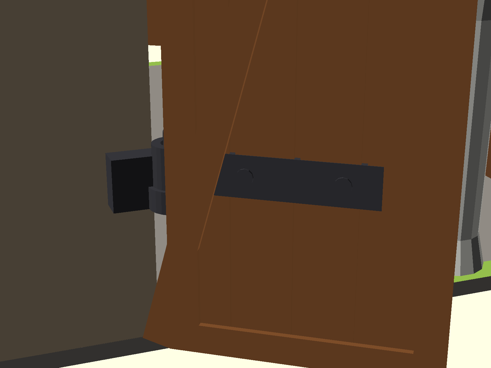
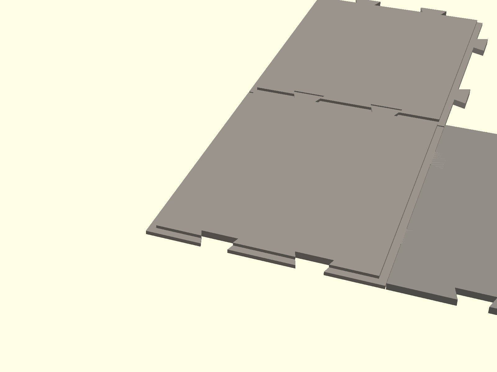
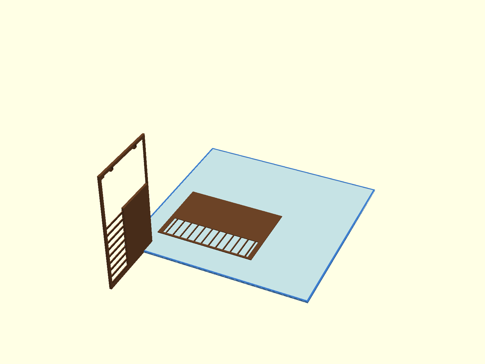
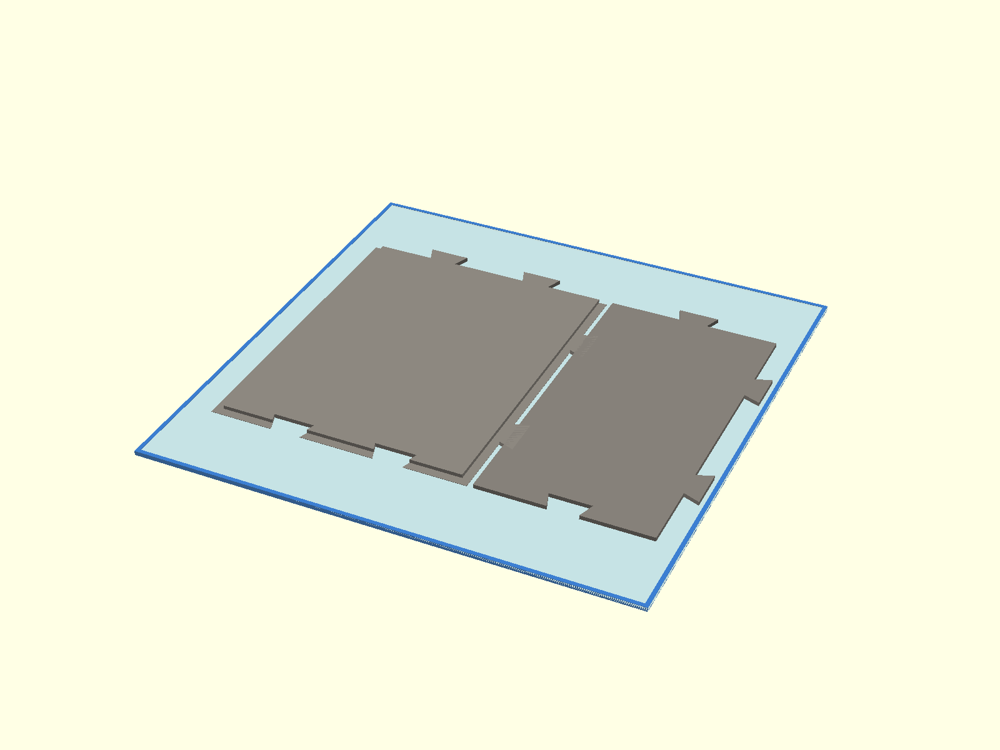
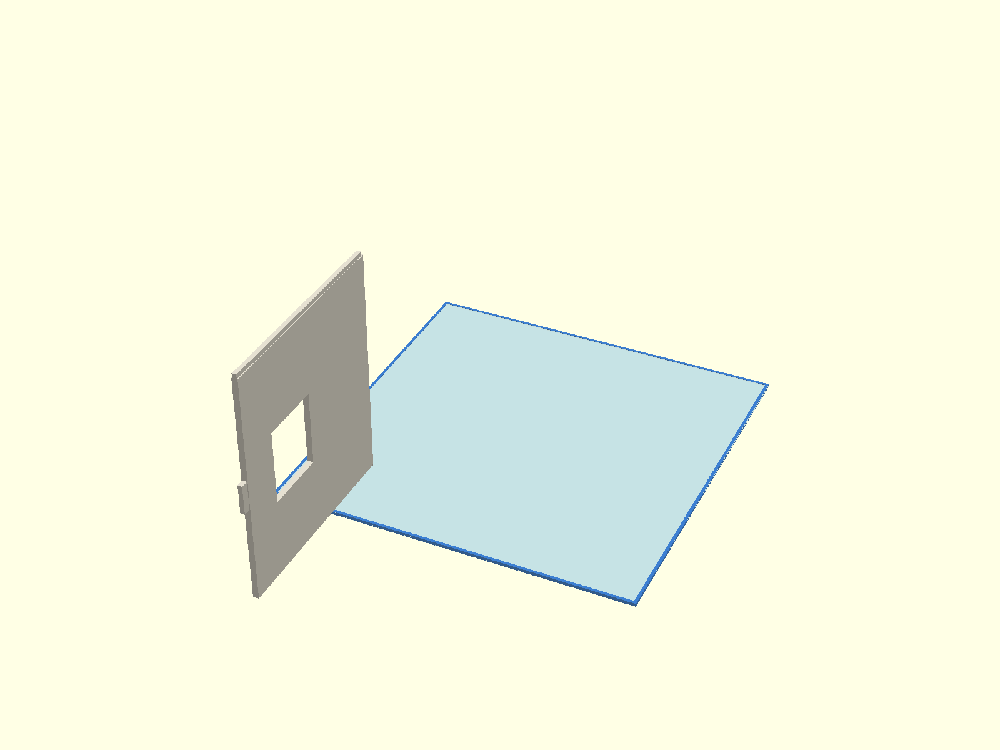
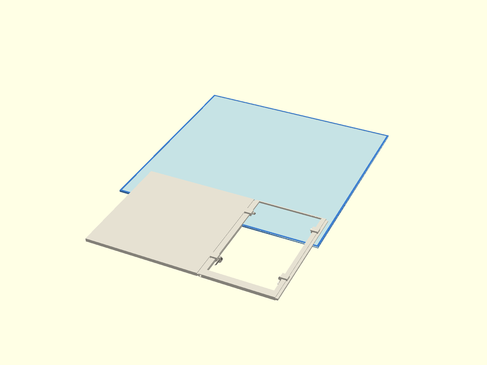
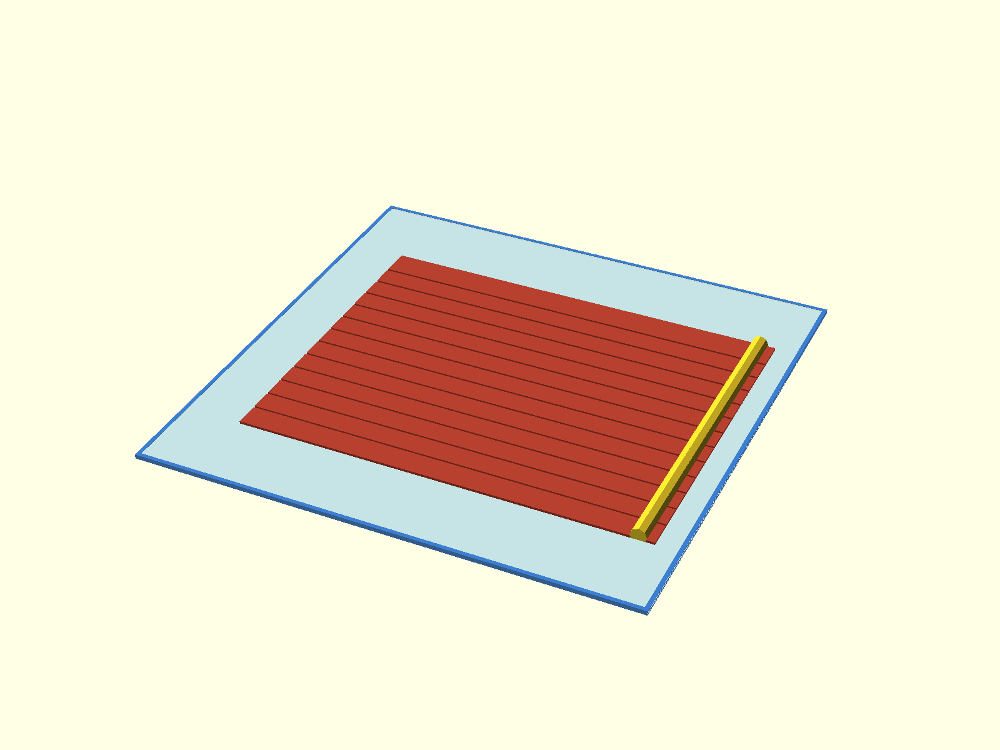
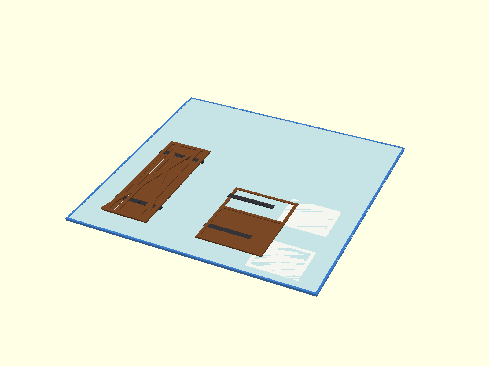

# Modułowa Stajnia dla Koni (Skala 1:24 - Schleich)

Parametryczny model modułowej stajni dla koni zaprojektowany w programie **OpenSCAD**, zoptymalizowany pod drukarkę 3D **QIDI Q1 Pro** (pole robocze 245 × 245 × 240 mm).

---

## Galeria Projektu

### Widok Ogólny i Wnętrze z Koniem
| Budynek stajni z modelem konia | Wnętrze stajni (rzut bez dachu) |
| :---: | :---: |
|  |  |

| Wrota główne i prześwit dla konia | Montaż modułowy segmentu (Exploded View) |
| :---: | :---: |
|  |  |

---

## Mechanika i Detale Konstrukcyjne

| Tradycyjne zawiasy stajenne (sworzeń + tuleja) | Zamki jaskółczy ogon (Dovetail) w posadzce |
| :---: | :---: |
|  |  |

---

## Podział na Stoły Robocze QIDI Q1 Pro (245 × 245 mm)

Dzięki podziałowi na grupy kolorystyczne poszczególne elementy można wygodnie drukować z osobnych szpul filamentu bez konieczności używania systemu wielomateriałowego (AMS/MMU):

| 1. Boksy Wewnętrzne (Filament Brązowy / Drewno) | 2. Posadzka (Filament Szary / Beton) |
| :---: | :---: |
|  |  |
| *Front boksu + przegroda międzyboksowa* | *Posadzka boksu (140×200) + korytarz (95×200)* |

| 3. Ściana Boczna (Filament Biały / Jasny) | 4. Szczyt i Brama (Filament Biały / Jasny) |
| :---: | :---: |
|  |  |
| *Ściana boczna z oknem (170×200 mm)* | *Filary szczytowe + portal wejściowy wrót* |

| 5. Połać Dachu (Filament Czerwony / Terakota) | 6. Drzwi, Wrota i Okna (Filament Akcentowy) |
| :---: | :---: |
|  |  |
| *Połać dachu na płasko (0 podpór) + kalenica* | *Skrzydła wrót, drzwi boksowe, ramy okien* |

---

## Główne Cechy Projektu

1. **System Rozbudowy Segmentowej:**
   - Dowolna liczba boksów: stajnia składa się z powtarzalnych segmentów łączonych na zintegrowane **zamki jaskółczy ogon (dovetail)**.
   - 1 segment = 2 boksy (lewy i prawy) + odcinek korytarza.
   - Zmiana parametru `liczba_segmentow` w OpenSCAD natychmiast generuje stajnię z 2, 4, 6, 8 itd. boksami.

2. **Dopasowanie do Koni w Skali 1:24 (Schleich):**
   - Skalibrowany pod rzeczywiste figurki koni o gabarytach do **171 mm długości, 50 mm szerokości i 150 mm wysokości**.
   - Boks: **200 × 140 mm** (pełna swoboda stania wzdłuż i wszerz).
   - Wrota główne: **85 mm szerokości × 162 mm wysokości** (bezpieczny prześwit 12 mm nad uszami konia).
   - Korytarz centralny: **95 mm szerokości**.
   - Ściany: **170 mm wysokości** (245 mm pod kalenicą dachu).

3. **Optymalizacja pod Drukarkę QIDI Q1 Pro (245 × 245 mm):**
   - Żaden pojedynczy element nie przekracza 200 mm długości / 170 mm szerokości.
   - Ściany szczytowe podzielone na filary boczne i portal wrót.
   - Trójkąt szczytowy i krokwie podzielone na połówki.
   - Połacie dachu drukowane na płasko bez podpór.

4. **Tradycyjne Mechaniczne Zawiasy Stajenne (Pintle & Strap):**
   - Ściany posiadają pionowe sworznie zawiasowe (czopy).
   - Skrzydła wrót i drzwi boksów mają tuleje obrotowe nasuwane od góry na sworznie.
   - Montaż bez użycia śrub czy drucików.

---

## Zestawienie Plików STL

### Posadzka (szczepiana na dovetail)
* `panel_podloga_boks.stl` – posadzka 1 boksu z rowkami na ściany (140 × 200 mm)
* `panel_podloga_korytarz.stl` – posadzka korytarza środkowego (95 × 200 mm)

### Boksy Wewnętrzne
* `panel_front_boksu.stl` – ściana od korytarza ze sworzniami zawiasów (200 × 110 mm)
* `panel_przegroda.stl` – ścianka działowa między boksami (140 × 110 mm)
* `stajnia_drzwi.stl` – drzwi boksowe typu holenderskiego oraz skrzydła wrót głównych

### Ściany Zewnętrzne i Szczyty
* `panel_sciana_boczna.stl` – ściana boczna z oknem (200 × 170 mm)
* `szczyt_filar_boczny.stl` – boczny filar ściany szczytowej (144 × 170 mm)
* `szczyt_portal_wrot.stl` – portal bramy wejściowej z zawiasami (95 × 170 mm)
* `szczyt_trojkat_polowa.stl` – połówka trójkąta szczytu dachu (192 × 75 mm)
* `stajnia_okna.stl` – ramy okienne z kratami ochronnymi

### Dach
* `polac_dachu_pojedyncza.stl` – pojedyncza połać dachowa drukowana na płasko (200 × 200 mm)
* `krokiew_polowa.stl` – połówka wiązara dachowego (180 × 75 mm)
* `modul_dach_segment.stl` – kompletny segment dachu (dla większych drukarek)

---

## Zalecenia Dotyczące Druku 3D (FDM)

* **Materiał:** PLA lub PETG
* **Wysokość warstwy:** 0.20 mm (dla detali zawiasów i krat zalecane 0.16–0.20 mm)
* **Wypełnienie (Infill):** 15–20% (wzór Gyroid lub Grid)
* **Ściany (Perimeters):** 3 obrysy
* **Podpory (Supports):**
  - Połacie dachu, posadzki i ściany leżące płasko: **0 podpór**
  - Panele ze sworzniami zawiasów: zalecane podpory tylko pod poziomymi półkami wsporników zawiasowych
* **Luz pasowania:** w modelu uwzględniono fabryczny luz montażowy $0.35\text{ mm}$ dla zamków dovetail oraz $0.45\text{ mm}$ dla ościeżnic i zawiasów.
