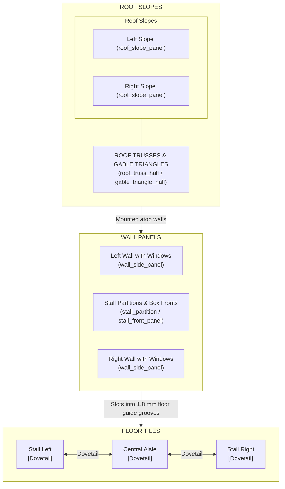
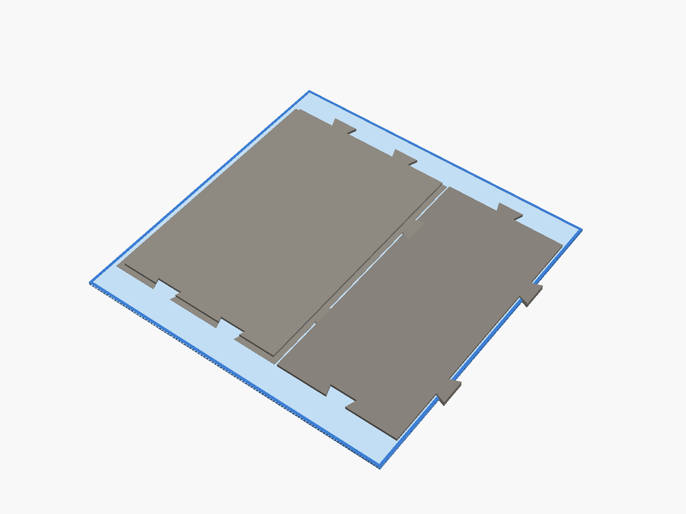
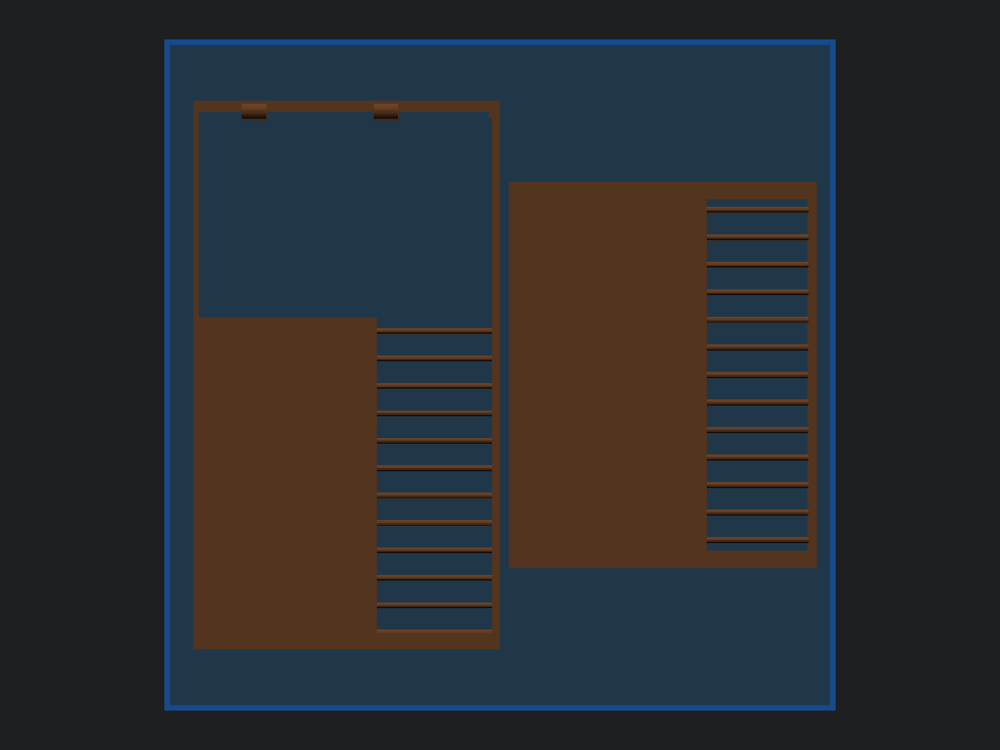
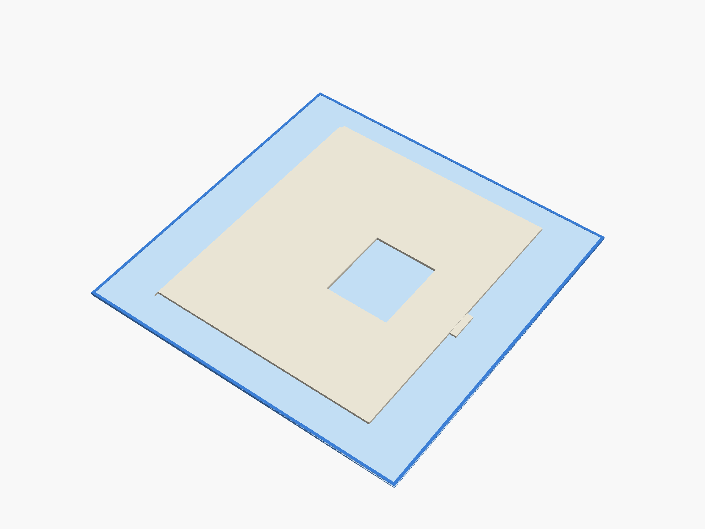
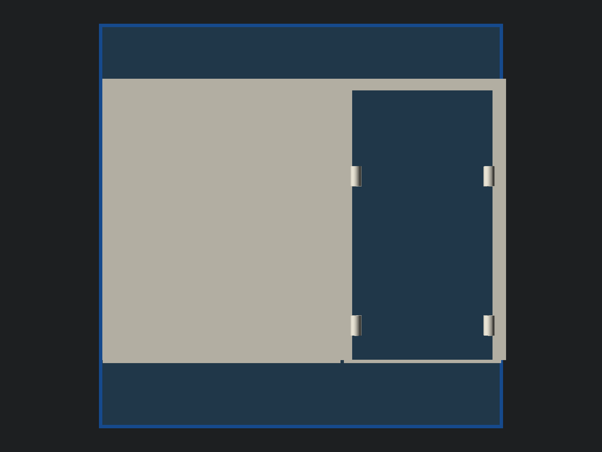
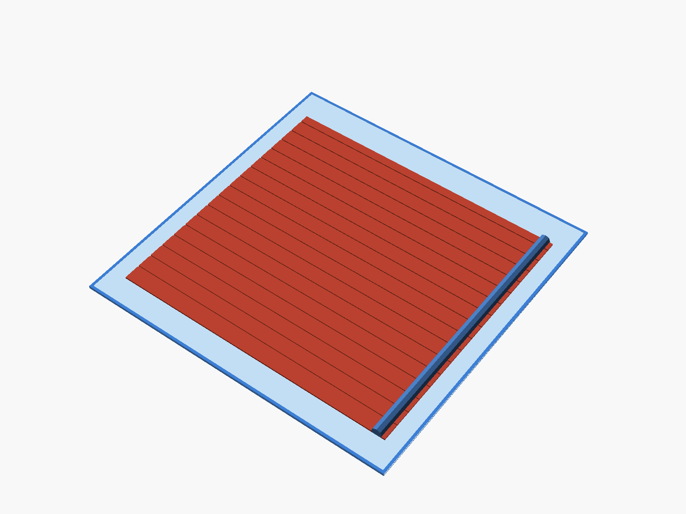
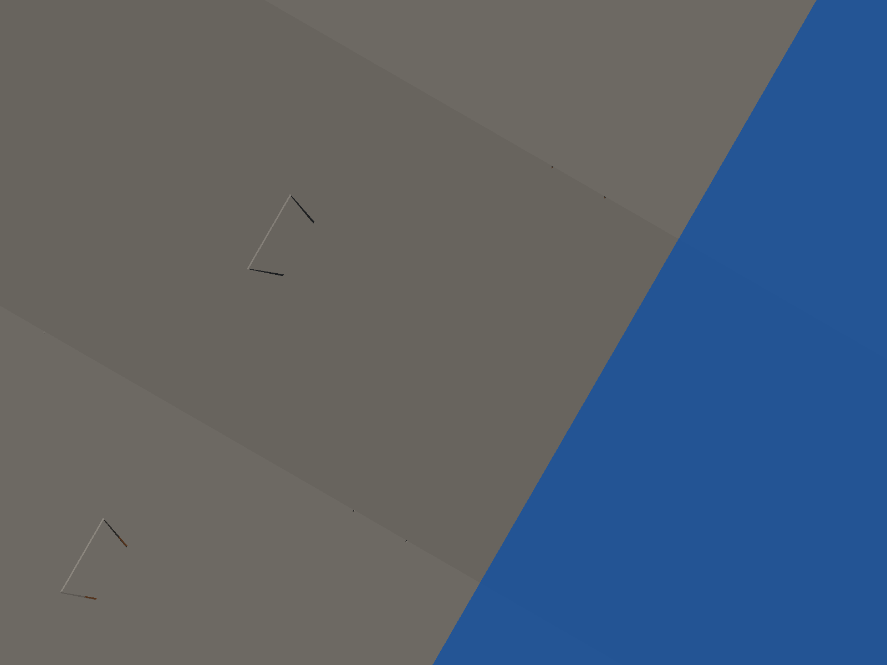

# Modular Horse Stable (1:24 Scale) — Assembly Guide

Welcome to the assembly guide for the **Modular Horse Stable** system, designed for 1:24 scale model horses (including Schleich, CollectA, Safari Ltd., and custom 3D printed horse models up to 150 mm tall and 171 mm long).

Every part is optimized to print on compact 3D printer beds such as the **QIDI Q1 Pro ($245 \times 245 \times 240\text{ mm}$)** without requiring multi-material systems (AMS/MMU) or excessive support structures.

---

## Table of Contents
1. [Required Tools & Materials](#required-tools--materials)
2. [Print Settings & Filament Recommendations](#print-settings--filament-recommendations)
3. [Bill of Materials (BOM)](#bill-of-materials-bom)
4. [Step-by-Step Assembly](#step-by-step-assembly)
   - [Step 1: Floor Base Assembly (Dovetail Joints)](#step-1-floor-base-assembly)
   - [Step 2: Stall Partitions & Front Panels](#step-2-stall-partitions--front-panels)
   - [Step 3: Exterior Side Walls](#step-3-exterior-side-walls)
   - [Step 4: Gable Walls & Main Portal](#step-4-gable-walls--main-portal)
   - [Step 5: Doors, Gates & Window Hardware](#step-5-doors-gates--window-hardware)
   - [Step 6: Roof Trusses & Slopes](#step-6-roof-trusses--slopes)
5. [Modular Expansion (Adding Extra Stalls)](#modular-expansion)
6. [Tolerances & Troubleshooting](#tolerances--troubleshooting)

---

## Required Tools & Materials

* **1.75 mm Filament scrap snippets** (standard 3D printer filament — PLA, PETG, ABS, etc.) or $1.8\text{ mm} - 2.0\text{ mm}$ metal wire / unbent paperclip: used as continuous hinge pivot pins.
* **Flush wire cutters**: For trimming the filament hinge pins flush after insertion.
* **Cyanoacrylate glue (Super Glue / CA glue)** or plastic cement (optional, for permanent lock; friction-fit dovetails can also remain tool-free).
* **Craft knife / Deburring tool**: For removing brim or elephant's foot.
* **Small hobby file / sandpaper (240–400 grit)**: For smoothing dovetail edges if printed with high flow.
* **PTFE lubricant / silicone spray / wax** (optional): For ultra-smooth hinge operation.

---

## Print Settings & Filament Recommendations

### Recommended Slicer Settings
* **Layer Height:** `0.20 mm` (0.16 mm for doors/windows hardware)
* **Perimeters / Walls:** `3` or `4` (ensures strong hinge pins and dovetail tabs)
* **Top / Bottom Solid Layers:** `4`
* **Infill:** `15% - 20%` (Gyroid or Grid recommended)
* **Supports:** **None required** for all main panels, floor tiles, and roof slopes when oriented flat on the build plate.
* **Elephant's Foot Compensation:** `0.15 mm - 0.20 mm` (prevents tight dovetail joints).

### Recommended Multi-Color Spool Palette
| Component Batch | Color Suggestion | Material | Notes |
|---|---|---|---|
| **Stalls & Partitions** | Wood / Timber Brown | PLA / PLA Wood / PETG | Realistic wooden plank texture |
| **Floor Tiles** | Stone Gray / Concrete | PLA / PETG / Matte PLA | Cobblestone / concrete feel |
| **Exterior Walls & Gables** | Off-White / Cream / Brick Red | PLA / PETG | Half-timbered barn facade |
| **Roof Slopes & Ridge** | Terracotta Red / Charcoal | PLA / PETG | Traditional ceramic roof tiles |
| **Doors, Gates & Windows** | Forged Black / Anthracite | PETG / Tough PLA | Sturdy hinge pintles and metal grilles |

---

## Bill of Materials (BOM)

### Standard 2-Stall Starter Kit (1 Modular Bay + 2 Gables)

| Part File (`.stl`) | Qty | Dimensions ($X \times Y \times Z$ mm) | QIDI Q1 Pro Fit |
|---|---|---|---|
| [`floor_stall_tile.stl`](floor_stall_tile.stl) | 2 | $140 \times 200 \times 4$ mm | Fits ($200 < 245$ mm) |
| [`floor_aisle_tile.stl`](floor_aisle_tile.stl) | 1 | $95 \times 200 \times 4$ mm | Fits |
| [`wall_side_panel.stl`](wall_side_panel.stl) | 2 | $200 \times 4 \times 170$ mm | Fits flat ($200 \times 170$ mm) |
| [`stall_partition.stl`](stall_partition.stl) | 2 | $140 \times 4 \times 170$ mm | Fits flat |
| [`stall_front_panel.stl`](stall_front_panel.stl) | 2 | $200 \times 4 \times 170$ mm | Fits flat |
| [`gable_side_pillar.stl`](gable_side_pillar.stl) | 4 | $144 \times 4 \times 170$ mm | Fits flat |
| [`gable_doorway_portal.stl`](gable_doorway_portal.stl) | 2 | $95 \times 4 \times 170$ mm | Fits flat |
| [`gable_triangle_half.stl`](gable_triangle_half.stl) | 4 | $193 \times 4 \times 75$ mm | Fits flat |
| [`roof_slope_panel.stl`](roof_slope_panel.stl) | 2 | $200 \times 200 \times 2.8$ mm | Fits flat ($200 \times 200$ mm) |
| [`roof_truss_half.stl`](roof_truss_half.stl) | 4 | $190 \times 4 \times 75$ mm | Fits flat |
| [`main_gate_wing.stl`](main_gate_wing.stl) | 2 | $40 \times 3.5 \times 161$ mm | Fits flat |
| [`stall_door.stl`](stall_door.stl) | 2 | $74 \times 3 \times 104$ mm | Fits flat |
| [`window_frame.stl`](window_frame.stl) | 2 | $55 \times 4 \times 47$ mm | Fits flat |

*Note: For a 4-stall setup (`segment_count = 2`), double the quantities of floor tiles, side walls, stall partitions, stall fronts, doors, windows, and roof slopes.*

---

## Step-by-Step Assembly

### Step 1: Floor Base Assembly
1. Place the **`floor_aisle_tile`** flat on your work surface.
2. Align the male dovetail connectors of **`floor_stall_tile` (Left)** with the female dovetail sockets along the left edge of the aisle tile.
3. Slide the dovetails into place until flush.
4. Repeat for **`floor_stall_tile` (Right)** on the opposite side.
5. If assembling multiple bay segments, slide the next segment's aisle and stall tiles into the longitudinal dovetails along the front/rear edges.
6. *(Optional)* Apply a tiny drop of CA glue into each dovetail socket if you do not plan to disassemble the floor later.

---

### Step 2: Stall Partitions & Front Panels
1. Identify the guide grooves recessed ($1.8\text{ mm}$ deep) into the floor tiles.
2. Insert the **`stall_partition`** dividing panels into the lateral floor grooves.
3. Insert the **`stall_front_panel`** pieces into the longitudinal floor grooves bordering the central aisle.
4. Ensure the pre-modeled vertical dovetail columns interlock where the partition meets the front wall.
5. Verify that the pintle hinge pins on the stall door frames face toward the aisle.

---

### Step 3: Exterior Side Walls
1. Take the **`wall_side_panel`** components.
2. Slide the lower edge into the outermost longitudinal groove of the stall floor tiles.
3. Interlock the end dovetails with the partition walls.
4. Push firmly downwards until the wall sits completely seated against the floor base.

---

### Step 4: Gable Walls & Main Portal
1. At the front entrance of the stable:
   - Insert the **`gable_doorway_portal`** above the aisle end.
   - Insert the two **`gable_side_pillar`** panels on the left and right sides of the doorway.
2. Attach the triangular gable roof trusses:
   - Mount **`gable_triangle_half`** on the left and right sides atop the portal and side pillars.
   - The two halves meet at the apex ridge with a keyed center overlap.
3. Repeat for the rear gable wall (or use a closed portal configuration if preferred).

---

### Step 5: Doors, Gates & Window Hardware
The stable uses an **indestructible 1.75 mm filament-pin multi-knuckle hinge system**:

1. **Why this hinge design?**
   - Standard 3D-printed vertical pintle pins are notorious for snapping off along layer lines under mild shear force (~0.5 kg).
   - This design uses continuous interlocking knuckles with a 2.1 mm internal bore.
   - Inserting a scrap piece of 1.75 mm filament provides longitudinal polymer orientation with zero layer lines in the shear plane (~15–20 kg shear strength per hinge).
   - The lowest frame knuckle features a **blind bottom stop** (so the filament pin cannot fall out underneath).
   - The topmost frame knuckle features a **45° conical lead-in funnel** for instant, snag-free insertion.

2. **Main Barn Gates (`main_gate_wing`):**
   - Cut a ~120 mm length of standard 1.75 mm filament (or metal rod).
   - Align the gate wing knuckle straps between the upper and lower portal frame knuckles.
   - Insert the filament pin down through the top lead-in funnel until it reaches the blind bottom stop.
   - Snip the top of the filament pin flush with flush cutters.
   - Swing the gates open and closed to ensure smooth movement ($0^\circ$ to $120^\circ$).

3. **Stall Dutch Doors (`stall_door`):**
   - Cut a ~75 mm length of 1.75 mm filament.
   - Align the stall door knuckle straps with the knuckles on the stall front post.
   - Slide the filament pin through the top funnel until it bottoms out.
   - Snip flush.

4. **Window Grilles (`window_frame`):**
   - Push the window frames into the window openings in the side walls.
   - They feature an exterior mounting flange for a clean snap-fit without glue.

---

### Step 6: Roof Trusses & Slopes
1. Assemble the **`roof_truss_half`** brackets along the upper wall edges between modular segments.
2. Slide the **`roof_slope_panel`** pieces onto the roof incline.
3. Align the ridge beam into the top apex groove.
4. **Removable Roof Play Feature:**
   - The roof panels can be left unglued so that they can be easily lifted off for overhead access to play with horses and accessories inside the stalls!

---

## Modular Expansion

You can expand your stable indefinitely by printing additional bay segments:
* **1 segment** = 2 stalls ($200\text{ mm}$ total depth)
* **2 segments** = 4 stalls ($400\text{ mm}$ total depth)
* **3 segments** = 6 stalls ($600\text{ mm}$ total depth)
* **4 segments** = 8 stalls ($800\text{ mm}$ total depth)

To expand an existing stable:
1. Detach the rear gable wall.
2. Interlock the new floor tiles (`floor_stall_tile` and `floor_aisle_tile`) onto the existing base via the dovetail tabs.
3. Insert new side walls, partitions, and stall fronts into the new segment.
4. Re-attach the rear gable wall at the new end.
5. Add the new roof slope panels.

---

## Tolerances & Troubleshooting

| Issue | Cause | Solution |
|---|---|---|
| **Dovetail joints feel too tight** | First layer over-extrusion (elephant's foot) | Scrape the bottom edges with a deburring tool or craft knife. Enable slicer elephant foot compensation (`0.15 - 0.20 mm`). |
| **Filament pin is tight in knuckle bore** | Slight hole shrinkage or stringing | The knuckle bore is $2.1\text{ mm}$ (giving $0.175\text{ mm}$ radial clearance for $1.75\text{ mm}$ filament). If tight, run a $2.0\text{ mm}$ or $2.1\text{ mm}$ drill bit or paperclip through by hand. |
| **Door swing is stiff** | Surface friction between plastic layers | Apply a tiny drop of silicone oil, mineral oil, or rub with candle wax. |
| **Wall panels rock in floor groove** | Bed warping on thin long prints | Ensure clean build plate (wash with warm water & dish soap) and correct bed temperature ($55-60^\circ\text{C}$ for PLA, $75-80^\circ\text{C}$ for PETG). |

---

## Copyright

Copyright (c) 2026 **Bartosz Nowak**. All rights reserved.
