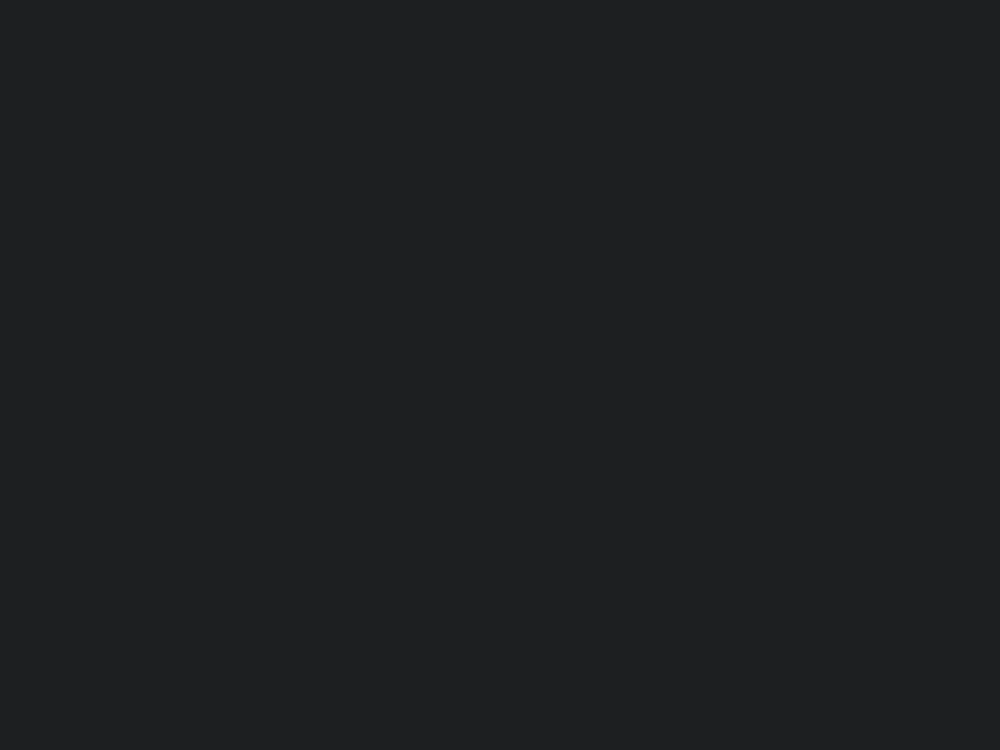
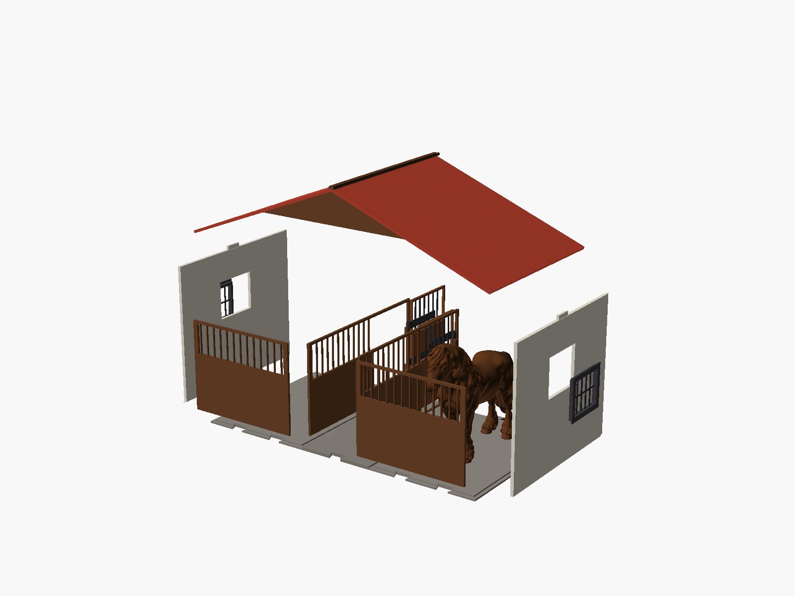
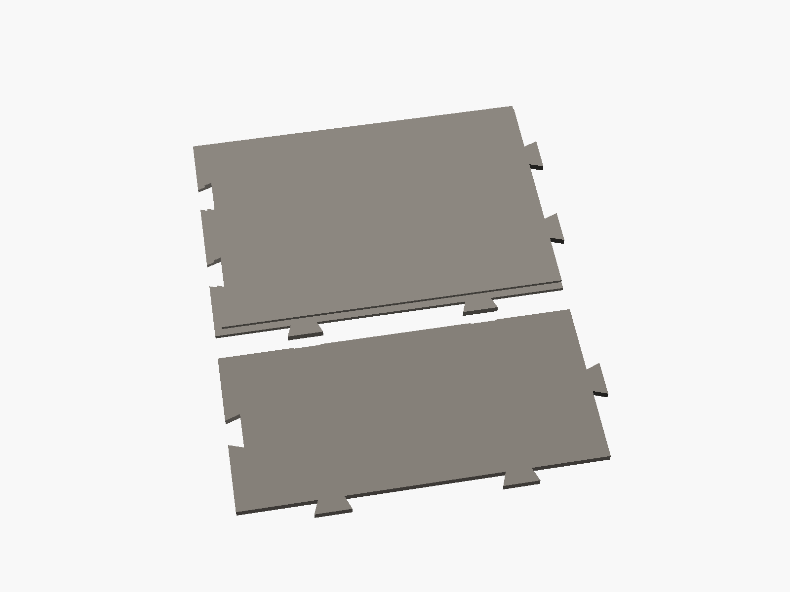
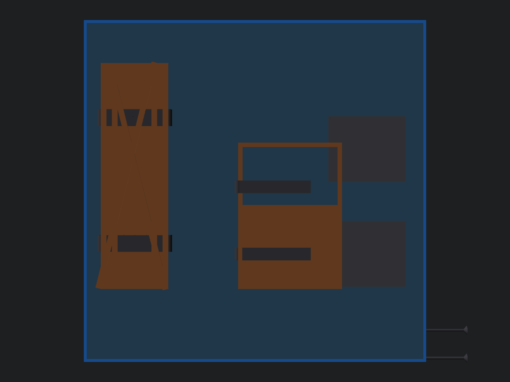

# Modular Horse Stable (1:24 Scale — Schleich Compatible)

A fully parametric, modular 3D printable horse stable system designed in **OpenSCAD** and engineered for desktop FDM 3D printers, specifically the **QIDI Q1 Pro** ($245 \times 245 \times 240\text{ mm}$ build envelope).

[-green.svg)](https://qidi3d.com)

---

## Gallery

### Overview & Scale Verification
| Complete Stable with Horses | Interior Bay View (Roof Off) |
| :---: | :---: |
|  |  |

| Barn Entrance & Doorway Clearance | Modular Exploded Segment Assembly |
| :---: | :---: |
|  |  |

---

## Mechanical Details & Joint System

| Indestructible Filament-Pin Knuckle Hinges | Sliding Dovetail Floor Joints |
| :---: | :---: |
|  |  |

* **Indestructible 1.75 mm Filament-Pin Knuckle Hinges:** Solves the notorious 3D printing hinge failure where vertical pintle pins snap along layer lines under shear load. Frame knuckles interlock with door knuckles around a continuous piece of standard 1.75 mm filament (or metal wire). The bottom knuckle has a blind stop so the pin never falls out, and the top knuckle has a 45° chamfered funnel for effortless, snag-free insertion.
* **Sliding Dovetails:** Segments interlock securely along the floor base and side walls using precision-toleranced dovetail joints ($0.35\text{ mm}$ fit clearance).
* **Tool-Free Removable Roof:** The modular roof lifts off effortlessly for top-down playtime and horse posing.

---

## Multi-Color Print Plates (QIDI Q1 Pro — $245 \times 245\text{ mm}$)

The design is organized into color-themed print plates, allowing full multi-color results without requiring an AMS/MMU multi-material unit. Swap spools between plate jobs:

| 1. Interior Stalls (Brown Wood Filament) | 2. Floor Tiles (Stone Gray Filament) |
| :---: | :---: |
|  |  |
| *Stall front panel + dividing partition* | *Stall floor tile ($140\times 200$) + aisle ($95\times 200$)* |

| 3. Exterior Side Wall (Cream/White Filament) | 4. Gable Wall Sections (Cream/White Filament) |
| :---: | :---: |
|  |  |
| *Side wall panel with window cutout ($170\times 200\text{ mm}$)* | *Gable side pillars + main entrance portal* |

| 5. Roof Slopes (Terracotta Red Filament) | 6. Hardware, Gates & Windows (Black Filament) |
| :---: | :---: |
|  |  |
| *Single slope panel ($200\times 200\text{ mm}$, 0 supports) + ridge* | *Gate wings, dutch doors, window grilles* |

---

## Key Dimensions & Scale Ergonomics

Calibrated for standard **1:24 scale model horses** (such as Schleich, CollectA, Safari Ltd., Breyer 1:24, and custom 3D printed horses up to $150\text{ mm}$ tall and $171\text{ mm}$ long):

* **Box / Stall Dimensions:** $200\text{ mm}$ long $\times 140\text{ mm}$ wide (plenty of room for a $171\text{ mm}$ horse to turn and rest).
* **Main Entrance Gate:** $85\text{ mm}$ wide $\times 162\text{ mm}$ tall ($12\text{ mm}$ safe clearance above ears of a $150\text{ mm}$ horse).
* **Stall Dutch Door:** $75\text{ mm}$ wide $\times 105\text{ mm}$ tall (horse's head comfortably looks over the door).
* **Central Aisle:** $95\text{ mm}$ wide (ample room for lead ropes and handlers).
* **Wall & Apex Height:** $170\text{ mm}$ wall height; $245\text{ mm}$ total interior height under the roof ridge.
* **100% QIDI Q1 Pro Compatible:** Maximum part dimension is $200\text{ mm}$, leaving a comfortable $45\text{ mm}$ safety margin on a $245\text{ mm}$ bed.

---

## STL File Index

### Floor Tiles (Interlocking Dovetails)
* [`floor_stall_tile.stl`](floor_stall_tile.stl) — Stall floor plate with wall guide grooves ($140 \times 200 \times 4\text{ mm}$)
* [`floor_aisle_tile.stl`](floor_aisle_tile.stl) — Central aisle floor plate ($95 \times 200 \times 4\text{ mm}$)

### Stall Interior
* [`stall_front_panel.stl`](stall_front_panel.stl) — Front stall wall facing the aisle, includes filament-pin frame knuckles ($200 \times 170\text{ mm}$)
* [`stall_partition.stl`](stall_partition.stl) — Dividing partition between stalls ($140 \times 170\text{ mm}$)
* [`stall_door.stl`](stall_door.stl) — Dutch stall door with iron grilles and integrated hinge knuckle straps ($74 \times 104\text{ mm}$)

### Exterior Walls & Gables
* [`wall_side_panel.stl`](wall_side_panel.stl) — Exterior side wall panel with window cutout ($200 \times 170\text{ mm}$)
* [`gable_doorway_portal.stl`](gable_doorway_portal.stl) — Front/rear entrance portal with filament-pin frame knuckles ($95 \times 170\text{ mm}$)
* [`gable_side_pillar.stl`](gable_side_pillar.stl) — Side pillar flanking the entrance portal ($144 \times 170\text{ mm}$)
* [`gable_triangle_half.stl`](gable_triangle_half.stl) — Half roof gable triangle with interlocking lap joint ($193 \times 75\text{ mm}$)

### Doors, Gates & Windows Hardware
* [`main_gate_wing.stl`](main_gate_wing.stl) — Single main barn gate wing with knuckle straps and cross-brace detailing ($40 \times 161\text{ mm}$)
* [`window_frame.stl`](window_frame.stl) — Snap-fit window frame with protective vertical iron bars ($55 \times 47\text{ mm}$)
* [`doors_windows_hardware.stl`](doors_windows_hardware.stl) — Combined hardware plate (2 gates, 1 stall door, 2 windows, and optional printable pins)

### Roof Structure
* [`roof_slope_panel.stl`](roof_slope_panel.stl) — Removable single roof slope with simulated ceramic tile texture ($200 \times 200\text{ mm}$, prints flat with 0 supports)
* [`roof_truss_half.stl`](roof_truss_half.stl) — Half roof truss connector ($190 \times 75\text{ mm}$)

### Full Pre-Arranged QIDI Q1 Pro Bed Batches
* [`qidi_bed_stalls.stl`](qidi_bed_stalls.stl) — Stall front + partition batch
* [`qidi_bed_floor.stl`](qidi_bed_floor.stl) — Stall floor + aisle floor batch
* [`qidi_bed_side_wall.stl`](qidi_bed_side_wall.stl) — Side wall batch
* [`qidi_bed_gable.stl`](qidi_bed_gable.stl) — Gable pillars + portal batch
* [`qidi_bed_roof.stl`](qidi_bed_roof.stl) — Roof slope + ridge beam batch

---

## Assembly Instructions

For detailed step-by-step assembly diagrams, bill of materials, and troubleshooting instructions, please refer to the complete manual:

👉 **[Read the Assembly Guide (ASSEMBLY.md)](ASSEMBLY.md)**

---

## Customization in OpenSCAD

All dimensions, clearances, and bay quantities are fully parameterized in [`stable.scad`](stable.scad).

To customize your stable:
1. Open [`stable.scad`](stable.scad) in [OpenSCAD](https://openscad.org).
2. Open the **Window > Customizer** panel.
3. Adjust `segment_count` (1 = 2 stalls, 2 = 4 stalls, 3 = 6 stalls, etc.).
4. Select individual parts or full assemblies via the `view` drop-down menu.
5. Render (`F6`) and export to STL (`F7`).

---

## Copyright

Copyright (c) 2026 **Bartosz Nowak**. All rights reserved.
