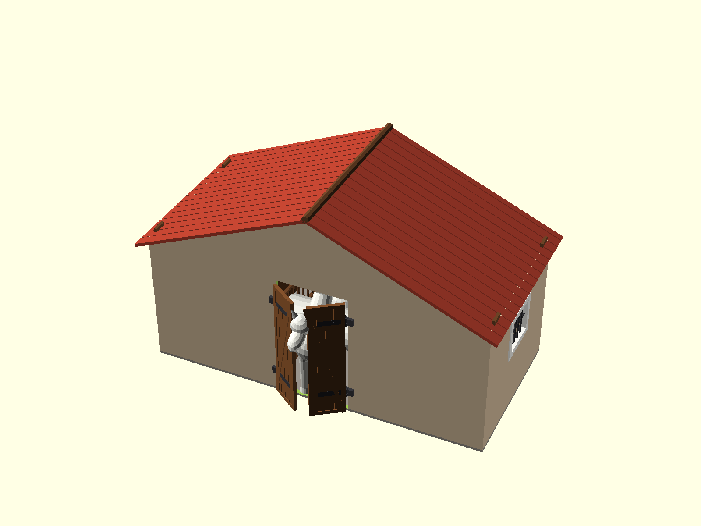
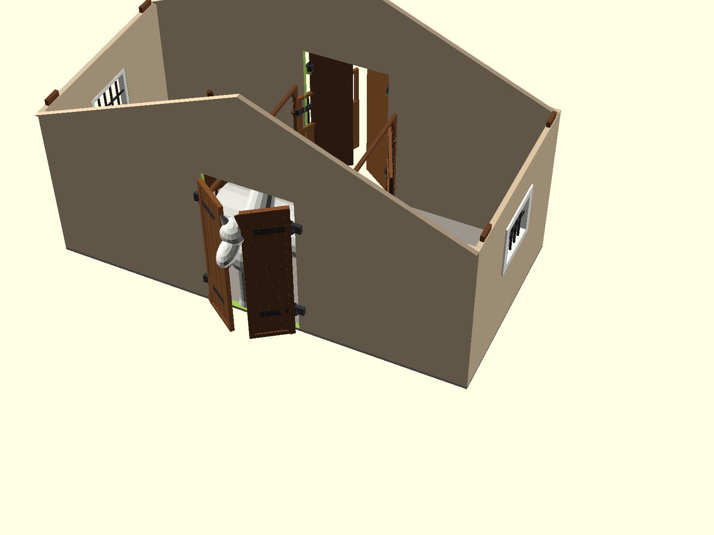
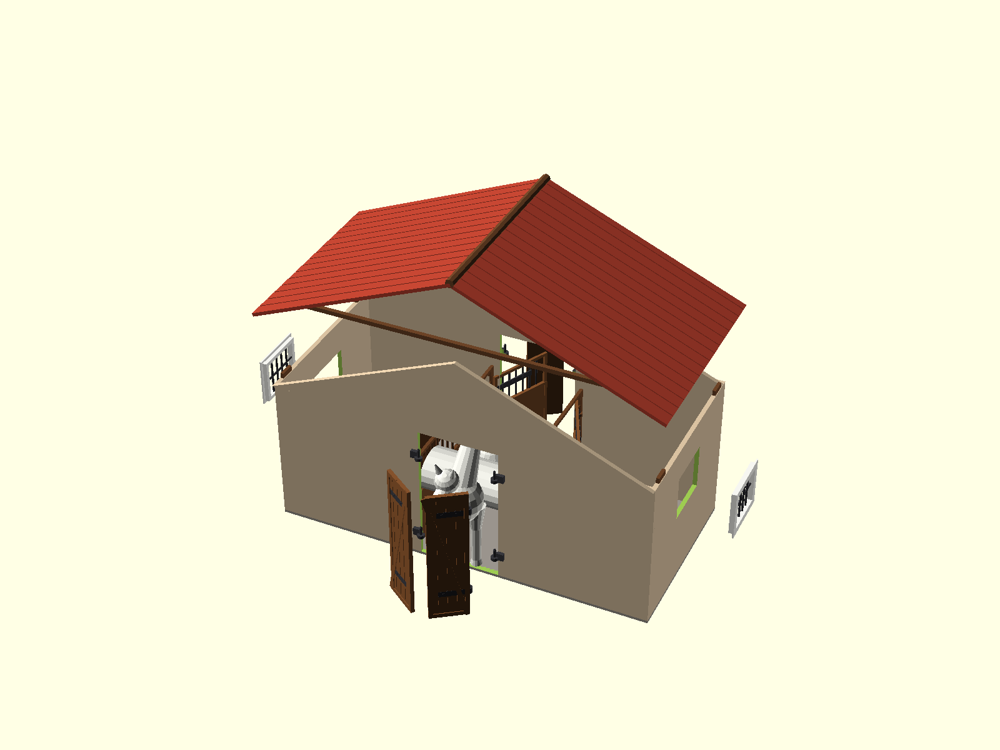
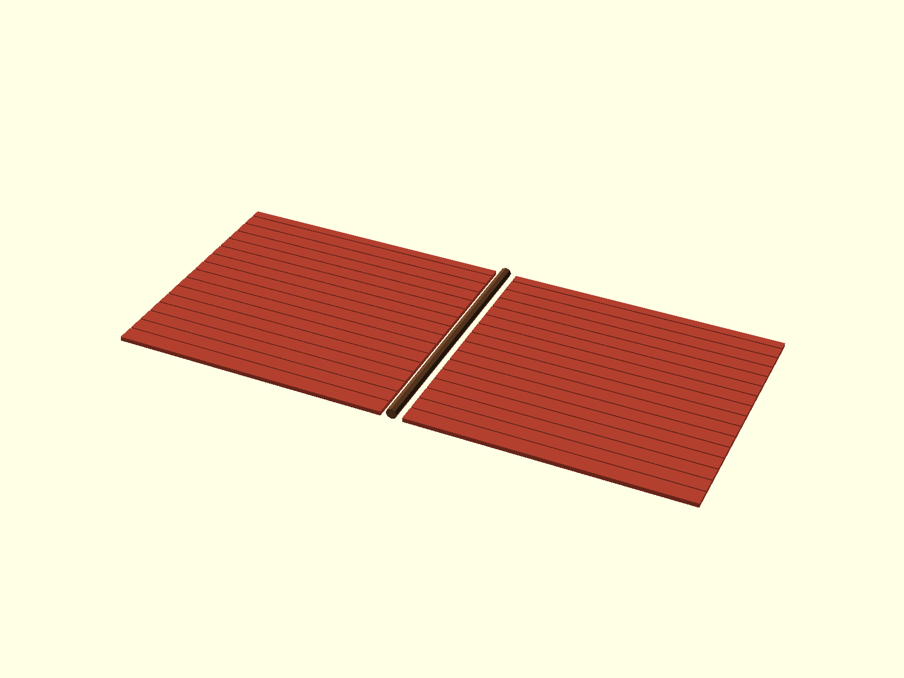
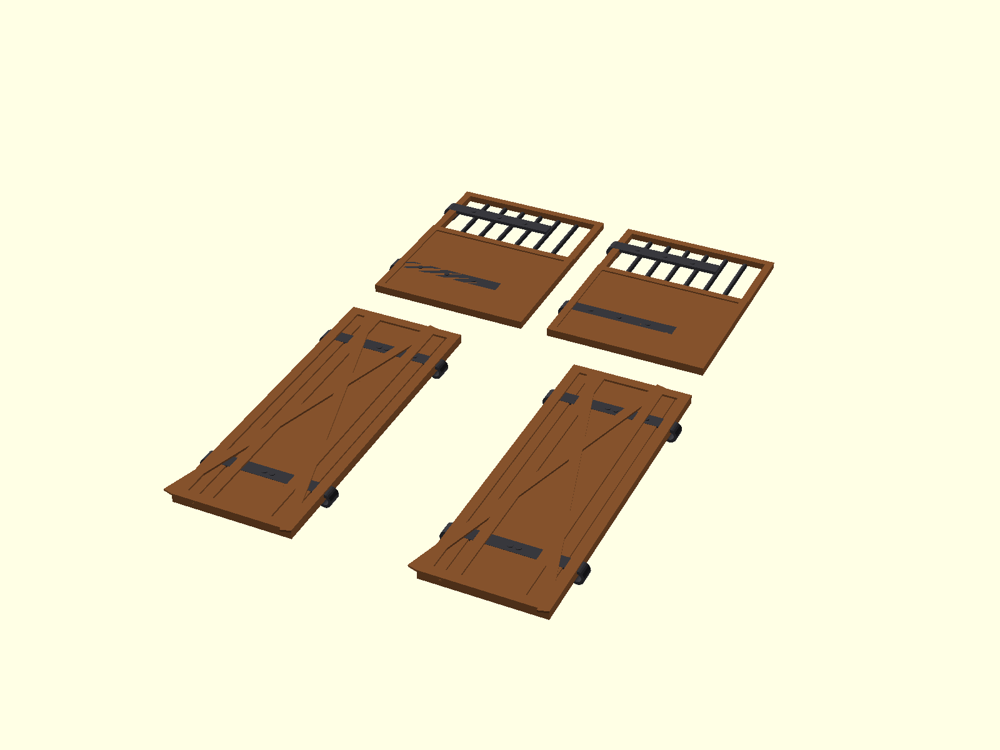

# Standard Monolithic Horse Stable (1:24 Scale — Schleich Compatible)

The **Standard Monolithic Horse Stable** is a complete, whole-building 3D printable stable model designed in **OpenSCAD** for 1:24 scale model horses (such as Schleich Horse Club, CollectA, Safari Ltd., and custom models).

Unlike the [Modular Stable](../modular/), which divides the stable into compact $\le 200\text{ mm}$ panels with dovetail joints for compact beds like the QIDI Q1 Pro ($245 \times 245\text{ mm}$), this **Standard version** features complete, unified structural assemblies (full perimeter walls with integrated stall dividers, full roof structure, and pre-grouped hardware). It is ideal for large-format 3D printers ($300 \times 300\text{ mm}$ or larger) or users looking for minimum assembly steps.

---

## Gallery

### Overview & Interior
| Complete Stable with Horses | Interior Stalls View (Roof Removed) |
| :---: | :---: |
|  |  |

| Main Entrance & Barn Doors | Exploded Component Assembly |
| :---: | :---: |
|  |  |

| Flat Printable Roof Slopes (0 Supports) | Drop-In Pintle & Strap Hinges |
| :---: | :---: |
|  |  |

---

## Key Features

1. **Monolithic Unified Shell:**
   - Exterior facade, stall dividers, and floor base printed as complete, rigid structural subassemblies.
2. **Functional Mechanical Barn Hinges (Pintle & Strap):**
   - Walls feature pre-modeled vertical pintle pins.
   - Gates and dutch stall doors feature matching eyelet barrel straps that slide directly onto the pins without screws or metal pins.
3. **Lift-Off Roof for Playtime:**
   - The full gable roof lifts off effortlessly for overhead access to play with horses and accessories inside the stalls.
4. **Zero-Support Flat Roof Option:**
   - Includes `stable_roof_flat.stl` allowing both roof slopes and the ridge beam to be printed flat on the print bed with zero support material.
5. **Calibrated for 1:24 Scale Model Horses:**
   - Tailored for model horses up to $145\text{ mm}$ long and $115\text{ mm}$ tall (with customizer parameters to scale up in `standard_stable.scad`).

---

## Dimensions

| Parameter | Dimension | Notes |
|---|---|---|
| **Total Width** | $353\text{ mm}$ | Exterior facade width (two stalls + central aisle) |
| **Total Length** | $168\text{ mm}$ | Depth of 2-stall standard configuration |
| **Wall Height** | $140\text{ mm}$ | Height to eaves |
| **Total Apex Height** | $215\text{ mm}$ | Interior height under roof ridge |
| **Stall Dimensions** | $160 \times 130\text{ mm}$ | Generous space for Schleich adult horses |
| **Central Aisle Width** | $85\text{ mm}$ | Clear hallway between stalls |
| **Main Entrance Gate** | $75 \times 130\text{ mm}$ | Clear passage for horses |

---

## File Index

### 3D Printable STL Files
* [`stable_walls.stl`](stable_walls.stl) — Complete monolithic wall structure including floor base, perimeter walls, and interior stall partitions ($353 \times 168 \times 140\text{ mm}$).
* [`stable_roof.stl`](stable_roof.stl) — Complete assembled gable roof with rafters, ridge beam, and textured roof tiles.
* [`stable_roof_flat.stl`](stable_roof_flat.stl) — Roof slopes and ridge beam laid out flat for FDM printing with zero supports.
* [`stable_doors.stl`](stable_doors.stl) — Main barn entrance gates and dutch stall doors with eyelet barrel straps.
* [`stable_windows.stl`](stable_windows.stl) — Snap-fit window frames with protective vertical metal grilles.

### Source Code
* [`standard_stable.scad`](standard_stable.scad) — Fully parametric OpenSCAD source file with Customizer support.

---

## Print Recommendations (FDM)

* **Bed Size Requirement:** $\ge 350 \times 200\text{ mm}$ for `stable_walls.stl` (or scale to 70% to fit on smaller beds).
* **Layer Height:** `0.20 mm`
* **Infill:** `15% - 20%` (Gyroid or Grid)
* **Perimeters:** `3` or `4`
* **Supports:** None needed for `stable_roof_flat.stl`, `stable_doors.stl`, and `stable_windows.stl`. Minimal tree supports recommended under door lintels for `stable_walls.stl`.

---

## License

This project is licensed under the **MIT License**. See [`LICENSE`](LICENSE) for details.

Copyright (c) 2026 **Bartosz Nowak**.
